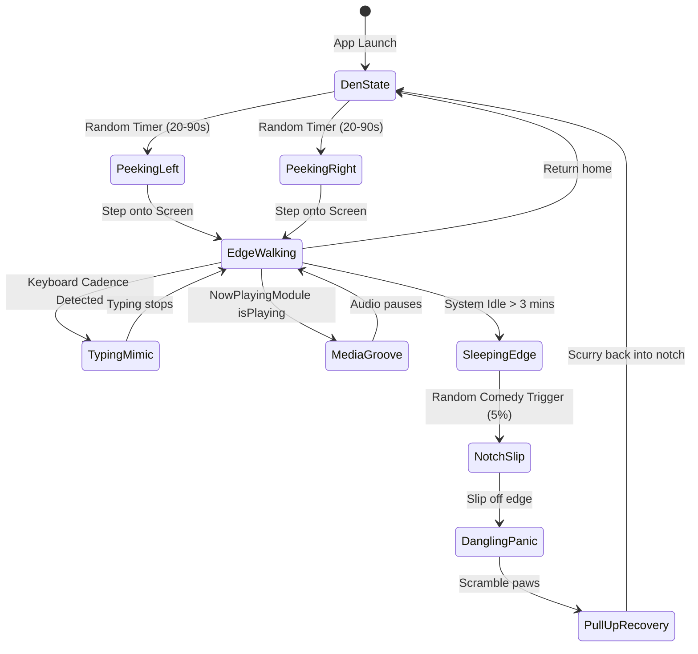
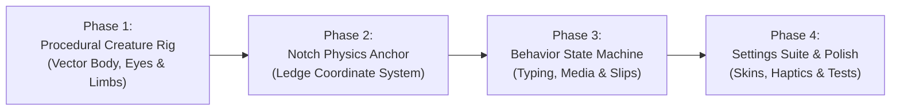

# Product Specification & Architecture MVP: Notch Animated Companion ("Notchy")
**Ambient Desktop Creature & Digital Hardware Companion for macOS**

---

## 1. Executive Vision & Philosophy

> *"Software shouldn't just be tools and toggles; the finest software has soul, whimsy, and presence."*

Every MacBook with a hardware display notch features a static physical cutout that sits motionless at the top of the screen. While Notchify turns this area into an Apple-grade utility hub, the **Notch Companion** transforms the hardware notch into a **living habitat**.

The Notch Companion is a tiny, charming, animated desktop creature that lives inside the physical bezel. It is **not** a game, **not** controllable with WASD, **not** an annoying popup, and **never** makes noise unless asked. It is an **ambient companion** designed to:
- Make long coding, writing, or studying sessions feel less isolated.
- Seamlessly interact with the physical geometry of your MacBook display.
- React authentically to what you are doing (mimicking rapid typing when you code, bobbing its head with headphones when Spotify/YouTube plays, dozing off when idle).
- Deliver subtle signature moments of delight (slipping off the notch lip, dangling comically by its paws, and scrambling back up).

---

## 2. Character Design & Visual Anatomy

```
              ┌────────────────────────┐
              │   Physical Notch Bezel │
              │                        │
       Left   │  [·]  Camera  [·]      │   Right
       Edge   │                        │   Edge
      ───────┐└────────────────────────┘┌───────
             │  \                      /  │
      Peeking│   \   Notch Lip Guard  /   │ Peeking
      Sprite │    └──────────────────┘    │ Sprite
             ▼                            ▼
```

### The Archetype: "Mochi" (The Default Creature)
- **Body Form:** A squishy, marshmallow-soft squircle body with gentle squash-and-stretch physics.
- **Eyes:** Two large, expressive rounded-pill cartoon eyes that blink, squint with laughter, or widen in panic when slipping.
- **Limbs:** Stubby little paws that can type on miniature props, wave at the cursor, or grip the bottom lip of the display notch.
- **Motion Characteristics:** Handcrafted spring physics (damping fraction `0.65`, response `0.32s`), squash-and-stretch on landing, subtle idle breathing cycle (2.4s period).
- **ProMotion 120Hz Fluidity:** Native macOS ProMotion display timing, rendering silky-smooth 60/120 FPS animations with sub-pixel anti-aliasing.

### Visual Themes & Collectible Skins
1. **Mochi (Classic Milk):** Minimalist warm-white marshmallow with subtle ambient occlusion shadow.
2. **Kuro (Obsidian Cat):** Deep midnight-black cat silhouette with glowing amber eyes and tiny pointed ears.
3. **Boba (Matcha Dino):** Pastel green mini dinosaur with rounded dorsal bumps.
4. **Pixel (Retro 8-Bit):** Nostalgic 16×16 retro game sprite with playful chunky pixel animations.
5. **Cyber (Neon Glitch):** Futuristic robotic chassis with an LED visor face that changes emoticons (`^__^`, `o_o`, `>_<`).

---

## 3. The Behavior State Machine & Animation Catalogue

The creature operates on a **stochastic state machine with environmental awareness**. It transitions naturally between states based on time intervals, user activity, and media playback.



### The 7 Core Animation Routines

#### 1. Inside the Den (Notch Interior / Zero CPU Idle)
- **Position:** 100% hidden behind the hardware notch bezel.
- **Action:** Sleeping, resting, or observing.
- **Performance:** **0.00% CPU**. The rendering layer is completely frozen (`paused = true`).

#### 2. The Curious Peek (Left / Right Wing)
- **Position:** Right at the curved bottom-left or bottom-right corner of the notch.
- **Action:** Two cute paws pop onto the screen, followed by its head poking out horizontally. It looks left, looks right, blinks twice, then either retreats or climbs fully out onto the screen!

#### 3. The Notch Tightrope Walk
- **Position:** Pacing along the very bottom horizontal lip of the notch.
- **Action:** Cute stubby feet waddle side-to-side. When it reaches the far corner, it peeks over the cliff of your screen, turns around, and waddles back.

#### 4. The Mimic Typer (Productivity Companion)
- **Trigger:** Detects typing activity on macOS (via passive event frequency or Notch Notes).
- **Action:** Pulls out a tiny miniature laptop or wooden typewriter, furiously clicks on it to match your typing pace, then wipes its little brow with a paw when you pause.

#### 5. The Music Groover (Media Jamming)
- **Trigger:** `NowPlayingModule.shared.isPlaying == true`.
- **Action:** Pulls on miniature oversized wireless headphones, sits cross-legged on the corner of the notch, and bobs its head up and down in sync with the beat. Tiny musical notes (`♪`, `♫`) drift upward and fade.

#### 6. The Signature "Notch Slip & Dangling Save" (Slapstick Comedy)
- **Trigger:** Random rare event (approx. once every 15–30 minutes) while sitting or dozing at the edge.
- **Sequence:**
  1. *The Doze:* Creature's head nods forward twice.
  2. *The Slip:* Foot slips on the sleek glass! Body drops downward 15pt past the notch line!
  3. *The Catch:* Both paws frantically clamp onto the bottom lip of the display notch!
  4. *The Dangling Panic:* Legs kick rapidly in mid-air; eyes widen into comically large circles.
  5. *The Scramble:* Grunts, pulls itself up with tiny shaking arms, rolls belly-first onto safe ground, breathes a sigh of relief, and scurries back inside the notch to hide.

#### 7. The Cozy Snooze
- **Trigger:** User hasn't typed or moved mouse for 3+ minutes.
- **Action:** Curls up into a ball right under the camera, breathes softly (subtle scale pulsation), with microscopic semi-transparent `"Zzz"` floating up.

---

## 4. Cursor Interactivity & Micro-Reactions

While the user cannot move the creature with arrow keys, it **reacts organically** to the user's cursor:

| Cursor Action | Creature Reaction |
|---|---|
| **Cursor approaches within 60pt** | Creature stops walking, turns head toward mouse, and eyes track the cursor coordinate. |
| **Hover directly over creature** | Creature perks up, wags its tail/body, or raises both paws in a cheerful wave. |
| **Fast flick / Quick swipe past** | Creature ducks down flat like a pancake, then pops back up shaking its head. |
| **Click on Creature** | Gentle squishy haptic feedback (`FeedbackManager.playClick()`), creature does a little 360° backflip with a happy spark particle! |

---

## 5. Architectural Implementation: Native SwiftUI Vector Engine

To maintain Notchify's strict **zero thermal footprint / zero battery drain** guarantee, we **reject** heavy web wrappers, Chromium runtimes, and large uncompressed GIF sequences.

### A. Rendering Strategy: Pure Procedural SwiftUI Shapes
Instead of 50MB sprite atlases or CPU-burning video decoders, the creature is rendered using **procedural vector SwiftUI paths**:
- **Geometry:** `RoundedRectangle`, `Circle`, `Path` with smooth bezier curvature.
- **Deformation:** Pure GPU-accelerated SwiftUI modifiers:
  ```swift
  .scaleEffect(x: squashX, y: stretchY, anchor: .bottom)
  .rotationEffect(.degrees(tiltAngle))
  .offset(x: positionX, y: positionY)
  ```
- **ProMotion Synchronization:** Utilizes `TimelineView(.animation)` with a strict `paused:` condition whenever the creature is in the den or sleeping.

### B. Thermal & CPU Budget Invariants
| Metric | Budget Target | Implementation Guarantee |
|---|---|---|
| **Idle CPU (in Den / Asleep)** | **0.00%** | Display link completely disconnected; no timers ticking. |
| **Active Animation CPU** | **< 0.8%** | Simple vector path translation accelerated by macOS Metal compositor. |
| **Memory Footprint** | **< 4.5 MB** | Zero bitmap storage; procedural vector math. |
| **Network & Disk I/O** | **0.00 bytes** | Fully local, zero analytics, zero telemetry. |

---

## 6. Privacy & macOS System Safety Guarantee

> [!IMPORTANT]
> ### 100% Privacy Guarantee
> - The creature **does NOT use the webcam** (camera is never activated for eye tracking).
> - The creature **does NOT use the microphone** (no ambient listening).
> - The creature **does NOT log keystrokes** (it only measures raw event cadence frequency, never characters or passwords).
> - The creature **does NOT transmit data** (zero internet connection required).

---

## 7. Settings & Configuration Suite

A dedicated category in the responsive Settings window (`SettingsCategory.companion`):

```
┌────────────────────────────────────────────────────────┐
│  🐾 Notch Companion                                    │
│                                                        │
│  [ Toggle ] Enable Desktop Creature        [ ON / OFF ]│
│                                                        │
│  CREATURE STYLE                                        │
│  [ Mochi (Fluff) ] [ Kuro (Cat) ] [ Boba (Dino) ] [...]│
│                                                        │
│  ENERGY & FREQUENCY                                    │
│  Activity Level:  [ Calm (Rare) ────●──── Playful ]    │
│                                                        │
│  BEHAVIORS                                             │
│  [✓] Mimic typing during work sessions                 │
│  [✓] Bob to music with tiny headphones                 │
│  [✓] Comedy slips and notch ledge grabs                │
│  [✓] Go to sleep during macOS Do Not Disturb           │
│                                                        │
│  INTERACTION                                           │
│  [✓] React to mouse hover & cursor clicks              │
└────────────────────────────────────────────────────────┘
```

---

## 8. Development & Implementation Roadmap



- **Phase 1: Procedural Vector Character Rigging**
  - Implement `CreatureBodyView` with smooth squircle bezier curves, blinking eyes, and animated paws.
  - Implement squash-and-stretch spring motion model.
- **Phase 2: Hardware Notch Anchor & Window Layering**
  - Anchor coordinate system directly to `NotchGeometry.current(for: screen)`.
  - Position rendering layer seamlessly at `NotchPanel.level = .screenSaver` so it walks right along the display notch contour.
- **Phase 3: Context Reactive State Machine**
  - Connect to `NowPlayingModule.shared.$isPlaying` for headphone jamming.
  - Connect to typing cadence for mini-typewriter mode.
  - Implement the signature slipping, dangling panic, and recovery pull-up animation.
- **Phase 4: Settings Integration, Skins & Verification**
  - Add Settings tab with skin picker and behavior toggles.
  - Add automated test contracts (0% CPU when in den, physics bounding checks).
