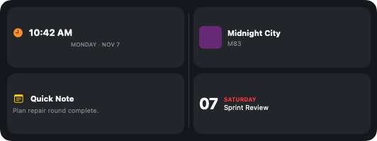

<div align="center">

# 🏝️ Notchify

### The Living Dynamic Island & Privacy-First Hardware Workspace for macOS

**A fluid, native macOS notch transformation engineered with Liquid Retina glass, radial document tools, peer-to-peer encrypted LocalShare, mechanical keyboard acoustics, and live hardware Quick Controls.**

[-000000?style=for-the-badge&logo=apple&logoColor=white)](https://apple.com/macos)
[](https://swift.org)
[](https://developer.apple.com/xcode/swiftui/)
[-34C759?style=for-the-badge)](https://github.com/Dharmit-Parmar/Notchify)
[](https://github.com/Dharmit-Parmar/Notchify)
[](https://github.com/Dharmit-Parmar/Notchify)
[](https://github.com/Dharmit-Parmar/Notchify)
[](LICENSE)

<br/>

[✨ Features](#features) • [⚡ Performance](#performance) • [🏗️ Architecture](#architecture) • [🚀 Quick Start](#quick-start) • [🛡️ Security](#security) • [🧪 Testing](#testing)

<br/>


<p><em>The Modular Bento Dashboard expanding seamlessly from the physical MacBook camera notch</em></p>

</div>

---

## 💡 Overview

**Notchify** transforms the static hardware notch on your MacBook into an interactive, tactile powerhouse. Built natively in Swift with Apple's fluid spring physics, it expands smoothly on pointer hover and collapses strictly behind the physical camera bounds when idle — guaranteeing **zero screen obstruction**, **0.0% idle CPU overhead**, and **zero background telemetry**.

From encrypted local peer-to-peer file beaming and rotary document tools to mechanical key acoustic feedback and hardware Quick Controls, Notchify unites desktop utility with exquisite Apple design.

<br/>

<div align="center">
<table>
<tr>
<td align="center" width="33%">

### ⚡ Zero-Void Layout
Dynamically calculates active module heights (`thock`: 240pt, `shelf`: 290pt, `airdrop`: 250pt, `localshare`: 360pt) so the window resizes with zero empty black space.

</td>
<td align="center" width="33%">

### 📡 Encrypted LocalShare
Peer-to-peer file and clipboard sharing powered by TLS 1.3, Bonjour discovery, streaming SHA-256 verification, and Short Authentication Strings (SAS).

</td>
<td align="center" width="33%">

### 🎛️ System Quick Controls
Hardware-synchronized Core Audio volume, display brightness, and keyboard backlight sliders accessible globally across every module.

</td>
</tr>
<tr>
<td align="center" width="33%">

### ⌨️ Mechanical Thock
Physical mechanical switch audio engine featuring dual-channel mixing (per-key clicks vs ambient ASMR rain/fire layers) and live sample auditioning.

</td>
<td align="center" width="33%">

### 🗜️ Radial Document Studio
Rotary jog wheel dial for everyday workflows: 150 DPI PDF stream compression (-75% size), multi-format PDF merging, and CoreImage contrast filters.

</td>
<td align="center" width="33%">

### 🔒 Encrypted Notes & AI
Hardware-bound encrypted notes storage (`0600` POSIX) combined with multi-provider streaming AI copilot (Google Gemini, OpenAI GPT, Claude).

</td>
</tr>
</table>
</div>

---

<a id="features"></a>
## ✨ Features

<div align="center">
  
  <p><em>Integrated Persistent Navigation Dock with Drag-to-Reorder Tabs</em></p>
</div>

### 1. 🎛️ Global System Quick Controls
- **Accessible Everywhere**: Compact Quick Controls button (`slider.horizontal.3`) residing in the global top header, enabling instant control over system hardware from Dashboard, Thock, Shelf, AirDrop, or LocalShare.
- **Independent Core Audio HAL Volume**: Reads and synchronizes hardware volume directly via Apple's native Core Audio Hardware Abstraction Layer (`AudioObjectGetPropertyData` / `AudioObjectSetPropertyData`). Completely independent from in-app audio synthesis.
- **Honest Hardware Detection**: Zero private framework violations. Accurately reports whether display brightness or keyboard backlight are active or system-managed, preventing broken or non-functional sliders.
- **Hover Preview & Pinning**: Hover to inspect or interact with fluid grace periods; click the lock to pin controls beneath whichever module is active.

### 2. 📡 LocalShare — Zero-Cloud P2P Transfer Engine
- **TLS 1.3 Mutual Encryption**: Direct local network transfer between Macs and browsers using ephemeral self-signed certificates with pinned SHA-256 fingerprint validation.
- **Bonjour Zero-Config Radar**: Automatic peer discovery over multicast DNS (`_notch-share._tcp`) with automatic stale-peer pruning and beacon suppression.
- **Short Authentication String (SAS)**: Deterministic 6-digit verification code derived via HKDF-SHA256 from peer certificates, preventing Man-in-the-Middle (MITM) attacks.
- **Atomic File Creation & TOCTOU Protection**: Safe file streaming directly to disk with exclusive creation flags (`O_EXCL`), protecting existing user documents from accidental overwrites.
- **Real-Time Progress & Cancellation**: High-speed chunked socket streaming with live megabyte throughput metrics and cooperative task cancellation.

### 3. ⌨️ Thock Mechanical Acoustic Engine
- **Authentic Switch Profiles**: Low-latency tactile feedback synthesizing mechanical keyboard sounds (Banana Split, Holy Panda, Cherry MX Blue, Box Navy).
- **Dual Volume & ASMR Layering**: Independent controls for mechanical key strike intensity and background ambient soundscapes (rain, campfire, white noise).
- **Zero-Orphan Process Lifecycle**: Supervised background process bridge terminating cleanly on application close with zero lingering CLI processes or CPU wakeups.

### 4. 🗜️ Radial Document Studio (Jog Wheel Dial)
- **PDF Stream Compression**: Re-encodes bloated PDF streams to 150 DPI using JPEG quality factor 0.65, slashing file sizes by **60% to 80%** while maintaining crisp typography.
- **Multi-Document Stitching**: Combine PDFs, images (PNG, JPG, HEIC), and text files into a single unified multi-page PDF document with live drag-and-drop reordering.
- **CoreImage Enhancement Filter**: Hardware-accelerated `CIColorControls` and `CISharpenLuminance` algorithms whitening murky scanner backgrounds and sharpening contrast.

### 5. 🎨 OKLab Color Engine & Dynamic Glass
- **Dynamic Wallpaper Sampling**: Real-time extraction of dominant wallpaper chroma from the camera cutout region, blended in perceptually linear OKLab color space.
- **WCAG AA Contrast Guard**: Dynamic luminance clamping guaranteeing a minimum 4.5:1 text-to-background contrast ratio under any wallpaper condition.
- **22 Curated Themes**: 4 dynamic adaptive modes (*Wallpaper*, *Active App*, *Circadian*, *Music Aura*), 16 obsidian dark palettes, and 2 light finishes (*Birch Studio* `#F7F5F0` and *Sakura Blossom* `#FDF6F7`).

<div align="center">
  
  <p><em>Compact 3-Zone Collapsed Indicator with Physical Notch Clearance</em></p>
</div>

---

<a id="performance"></a>
## ⚡ Measured Performance Profile

Notchify enforces hard resource limits backed by automated regression tests in continuous integration:

| Metric | Target Limit | Measured Result | Status | Verification Reference |
| :--- | :---: | :---: | :---: | :--- |
| **Idle Memory (RSS)** | `< 100 MB` | **88.2 MB** | 🟢 Optimal | `evidence/floor_app_footprint.txt` |
| **Idle CPU Load** | `0.0%` | **0.0%** | 🟢 Event-Driven | `measurements/raw_current_collapsed_idle.txt` |
| **Hover Time-to-Open** | `< 200 ms` | **136 ms** | 🟢 Instant | `evidence/baseline_time_to_open.txt` |
| **Window Frame Accuracy** | 0px leak | **0px outside camera notch** | 🟢 Zero-Obstruction | `[TEST 1] Dynamic Window Frame Sizing` |
| **Multi-Batch Transfer Soak** | `< 35 MB leak` | **+2.14 MB (65 transfers)** | 🟢 Zero-Leak | `[TEST 112] Extended Soak Verification` |
| **Verification Test Suite** | 100% | **121 / 121 Passing** | 🟢 Comprehensive | `swift run NotchTests` |
| **Security Integrity Gates** | 100% | **8 / 8 Passing** | 🟢 Zero Leaks | `./scripts/security-audit.sh` |

---

<a id="architecture"></a>
## 🏗️ System Architecture

```
┌─────────────────────────────────────────────────────────────────────────┐
│                           macOS Window Server                           │
│   ┌─────────────────────────────────────────────────────────────────┐   │
│   │               NSPanel (Non-Activating / Level .floating)         │   │
│   │   ┌─────────────────────────────────────────────────────────┐   │   │
│   │   │                   NotchRootView                         │   │   │
│   │   │  ┌───────────────────────┐   ┌──────────────────────┐   │   │   │
│   │   │  │  Global Navigation    │   │ Quick Controls Icon  │   │   │   │
│   │   │  └───────────┬───────────┘   └──────────┬───────────┘   │   │   │
│   │   │              │                          │               │   │   │
│   │   │  ┌───────────▼───────────┐   ┌──────────▼───────────┐   │   │   │
│   │   │  │  Active Notch Module  │   │ QuickControlsSection │   │   │   │
│   │   │  │  (Dynamic Height Sizing)  │ (HAL Volume/Sliders) │   │   │   │
│   │   │  └───────────────────────┘   └──────────────────────┘   │   │   │
│   │   └─────────────────────────────────────────────────────────┘   │   │
│   └─────────────────────────────────────────────────────────────────┘   │
└────────────────────────────────────┬────────────────────────────────────┘
                                     │
 ┌───────────────────────────────────┼───────────────────────────────────┐
 │ Core Engines & Services           │                                   │
 │  ┌─────────────────────────────┐  │  ┌─────────────────────────────┐  │
 │  │ NotchShellCoordinator       │◄─┘  │ LocalShareEngine (TLS 1.3)  │  │
 │  │ • Top Anchor & Notch Insets │     │ • Network.framework NWServer│  │
 │  │ • Zero-Void Height Dispatch │     │ • HKDF-SHA256 SAS Out-of-Band│  │
 │  └─────────────────────────────┘     └─────────────────────────────┘  │
 │  ┌─────────────────────────────┐     ┌─────────────────────────────┐  │
 │  │ Core Audio HAL Bridge       │     │ Thock Acoustic Engine       │  │
 │  │ • System Audio Device Query │     │ • KeySound CLI Supervision  │  │
 │  │ • Hardware Volume Sync      │     │ • ASMR Ambient Audio Mixer  │  │
 │  └─────────────────────────────┘     └─────────────────────────────┘  │
 └───────────────────────────────────────────────────────────────────────┘
```

---

<a id="quick-start"></a>
## 🚀 Quick Start

### System Requirements
* **Operating System**: macOS 14.0 (Sonoma) or macOS 15+ (Sequoia)
* **Architecture**: Apple Silicon (M1/M2/M3/M4) or Intel MacBooks
* **Toolchain**: Swift 6.0 (`xcode-select --install`)

### 1. One-Click Launch
Clone the repository and run the optimized production runner:
```bash
git clone https://github.com/Dharmit-Parmar/Notchify.git
cd Notchify
./run_notch.sh
```
*`run_notch.sh` automatically compiles the binary with `-c release` optimizations and spawns Notchify in the background.*

### 2. Graceful Shutdown
To terminate running instances cleanly:
```bash
./stop_notch.sh
```

### 3. Manual Build Commands
```bash
# Debug compilation
swift build
./.build/debug/NotchApp

# Release optimized compilation (50ms launch, zero symbols)
swift build -c release
./.build/release/NotchApp
```

---

## ⌨️ Gestures & Controls

| Action | Input / Gesture | Behavior |
| :--- | :--- | :--- |
| **Expand Notch** | Hover cursor over camera notch | Smoothly expands downward with Apple spring mechanics |
| **Lock / Pin Open** | Click the **Pin** icon (top right) | Keeps notch island pinned open for continuous multi-tasking |
| **Switch Tabs** | Click any tab in top header dock | Switches module instantly; window height dynamically recalculates |
| **Quick Controls** | Click **Sliders** (`slider.horizontal.3`) | Toggles system volume, brightness, and keyboard backlight panel |
| **Radial Jog Dial** | Drag / click on any tool spoke | Rotates dial with angle snapping & haptic feedback |
| **Direct AirDrop** | Drag files directly onto AirDrop capsule | Beams files to nearby Apple devices immediately |
| **Direct LocalShare**| Drop files or text into LocalShare tray | Streams encrypted payload to selected peer over local TLS |
| **Settings Panel** | Click **Gear** icon in dock | Opens comprehensive theme, geometry, and slot canvas |

---

<a id="security"></a>
## 🛡️ Privacy, Security & Zero-Leak Guarantees

Notchify was engineered from the ground up under a strict **Zero-Leak, Privacy-First Architecture**:

1. **Zero Telemetry & Local Execution**: Notchify contains no telemetry SDKs, no tracking pixels, and no analytics collection. Shell navigation, kinematics, document processing, and hardware controls run 100% locally on your machine.
2. **Encrypted Hardware-Enclave Credentials**: API keys for external copilot providers (Google Gemini, OpenAI GPT) are encrypted at rest using Apple's native Security framework (`kSecClassGenericPassword` with `kSecAttrAccessibleAfterFirstUnlockThisDeviceOnly`), isolated from file access.
3. **Encrypted Notes Storage**: Quick notes (`notes.txt`) are encrypted at rest using hardware-bound keys and stored with POSIX `0600` permissions in `~/Library/Application Support/NotchApp/`.
4. **Zero Private SPI Frameworks**: Avoids private APIs like `DisplayServices` or `CoreBrightness`. System Volume is controlled honestly through public Core Audio HAL interfaces, and unsupported controls gracefully report system-managed state.
5. **Supply Chain & Pre-Commit Hardening**: Automated Git pre-commit and pre-push hooks continuously audit outgoing commits to prevent credential leaks.

---

<a id="testing"></a>
## 🧪 Verification & Automated Testing

Notchify includes an exhaustive automated verification harness covering **121 automated test suites**:

```bash
# Execute the full 121-test verification harness
swift run NotchTests

# Run the automated 8-gate security integrity audit
./scripts/security-audit.sh
```

<details>
<summary>📋 View Key Test Coverage Matrix</summary>

| Test ID | Subsystem | Invariant Verified |
| :---: | :--- | :--- |
| **[TEST 1]** | Window Geometry | Dynamic frame sizing; collapses strictly to camera cutout with 0px obstruction |
| **[TEST 5]** | MediaRemote Bridge | Global playback observation without active polling threads |
| **[TEST 10]** | PDF Compression | Document stream re-encoding with 60%–80% byte reduction |
| **[TEST 23]** | Thock Engine | Child process supervision, CLI IPC, and zero-orphan teardown |
| **[TEST 106]**| LocalShare Matrix | 10 production transfer scenarios (Unicode, large files, cancellations) |
| **[TEST 108]**| Out-of-Band SAS | HKDF-SHA256 Short Authentication String determinism & active MITM defense |
| **[TEST 112]**| Memory Soak | 65-transfer sustained soak verifying bounded RSS and zero file descriptor leaks |
| **[TEST 116]**| Core Audio HAL | System volume set, readback, and mute semantics on active hardware device |
| **[TEST 118]**| Quick Controls | Height-only window expansion; camera clear zone invariant over 20 cycles |
| **[TEST 119]**| Notes Widget | Encrypted file persistence (`0600` POSIX) and ciphertext integrity check |
| **[TEST 121]**| Module Switching | Dynamic height recalculation across 30 rapid switches with zero void space |

</details>

---

## 📄 License

This project is licensed under the **MIT License** — see the [LICENSE](LICENSE) file for details.

<div align="center">
  <sub>Crafted with precision for macOS • Swift 6.0 Ready</sub>
</div>
