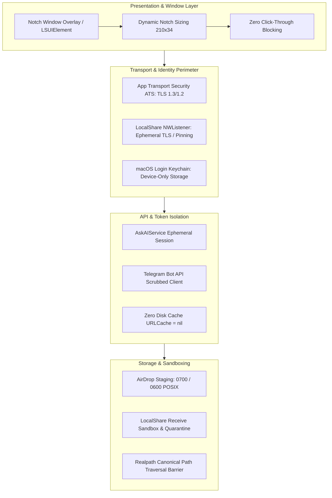

# NOTCHIFY — SECURITY ARCHITECTURE & DEFENSE-IN-DEPTH SPECIFICATION

**Application Architecture:** Notchify / NotchApp (macOS)  
**Document Revision:** 1.0  
**Target Architecture:** Apple Silicon (ARM64) & Intel (x86_64)  
**Date:** November 17, 2026  
**Status:** PRODUCTION HARDENED  

---

## 1. Architectural Overview & Security Boundaries

Notchify is architected around the principle of **layered defense-in-depth**, ensuring that a vulnerability or compromise in one subsystem cannot escalate into unauthorized file-system access, secret leakage, or cross-origin privilege escalation.

---

## 2. Security Subsystems & Invariants

### 1. Identity & Cryptographic Storage (SEC-01)
- **Keychain Scheme:** All persistent secrets (P-256 private key, X.509 certificate DER, optional security PIN) are anchored in the macOS login keychain (`kSecClassGenericPassword`).
- **Accessibility Class:** Enforces `kSecAttrAccessibleAfterFirstUnlockThisDeviceOnly`. Secrets cannot be retrieved prior to user login, while device is locked, or synced via iCloud Keychain.
- **Cross-Build Resilience:** Uses `SecAccessCreate(descriptor, nil, &access)` with a `nil` trusted list, enabling rebuilt binaries executing under UID 501 to decrypt identity records without prompting the user.
- **Thread Non-Blocking Guarantee:** `SecKeychainSetUserInteractionAllowed(false)` ensures Keychain Services returns immediate error codes (`errSecInteractionNotAllowed` / `errSecAuthFailed`) rather than trapping on Mach messages to `SecurityAgent`.
- **Fallback Migration:** Legacy unencrypted UserDefaults backups are migrated into Keychain on first access and immediately wiped.

### 2. Transport & ATS Network Security (SEC-02)
- **Global ATS Enforcement:** `NSAllowsArbitraryLoads` is disabled app-wide in `Info.plist`. All cloud endpoints (Google Gemini, OpenAI, Telegram Bot API) mandate TLS 1.2 or TLS 1.3 with forward secrecy.
- **Local Network Scope:** `NSAllowsLocalNetworking` is retained exclusively to permit mDNS discovery and peer-to-peer file transfer over Wi-Fi/Ethernet.
- **Certificate Fingerprinting:** Peer identification relies on SHA-256 fingerprint validation of the self-signed leaf certificate DER bytes (`LocalShareSecurity.isFingerprintValid`).
- **Certificate Mutation Defense:** If an existing trusted peer presents a certificate with a modified fingerprint, the session is quarantined and rejected with HTTP 403 (`LocalSharePeerTrustState.certificateChanged`).

### 3. API Token Protection & Zero-Cache Caching (SEC-03)
- **Ephemeral URLSessions:** `AskAIService` and `TelegramClient` initialize dedicated `URLSession` instances with `URLSessionConfiguration.ephemeral`.
- **Memory-Only Policy:** `urlCache = nil`, `httpCookieStorage = nil`, and `urlCredentialStorage = nil` prevent bearer tokens, API keys (`x-goog-api-key`), and user chat contexts from touching disk.
- **Scrubbed Diagnostics:** Error strings scrub raw tokens and authorization headers prior to logging or telemetry formatting.

### 4. LocalShare Server Concurrency & Session Mutex (SEC-04, SEC-05, SEC-06)
- **Single Active Session Mutex:** `LocalShareSessionCoordinator` enforces that only one incoming or outgoing transfer session can exist simultaneously. Subsequent connection attempts return HTTP 409 Conflict.
- **Synchronous Teardown:** Directory removal upon session cancellation or completion is executed synchronously outside the coordinator lock, eliminating race conditions with incoming transfer requests.
- **Thread Synchronization:** All mutable server configuration parameters (`serverAlias`, `requiredPin`, `autoAcceptFavorites`, `favoriteFingerprints`) are guarded behind `NSLock` instances to eliminate data races between `@MainActor` UI and background network dispatchers.
- **Dual-Tier Rate Limiting:** High-frequency discovery and registration routes are subject to sliding-window IP rate limiting (60 req/s), while authenticated file streaming routes (`/api/localsend/v2/upload`) are governed by cryptographically random single-use tokens and byte-count integrity watchdogs. Immediate HTTP Content-Length verification enforces strict parity with agreed session metadata, rejecting mismatches with HTTP 400 before stream allocation.

### 5. File System Containment & Storage Quarantine (SEC-08)
- **Path Traversal Barrier:** File destinations are canonicalized using `URL.resolvingSymlinksInPath()`. Attempts to escape the designated receive folder via `../`, absolute paths, or nested symlinks are strictly rejected.
- **Collision Resistance:** Destination conflicts automatically resolve by appending numeric counters (`file (1).ext`) rather than overwriting existing user data.
- **Transient Staging:** Dragged and pasted clipboard items in AirDrop are staged under `FileManager.default.temporaryDirectory/AirDropStaging/` with `0700` directory and `0600` file permissions. Staged files are tracked and deleted synchronously upon share completion or cancellation.
- **macOS Quarantine Tagging:** Received files are annotated with `com.apple.quarantine` extended attributes so Gatekeeper validates them before user execution.

### 6. Process Memory & Platform Governance (SEC-09)
- **Private SPI Elimination:** Zero private Darwin SPIs (`responsibility_get_pid...`) are linked.
- **Cooperative Memory Relief:** When the dynamic notch is collapsed and idle for >=30 seconds, `ProcessMemoryGovernor` issues `malloc_zone_pressure_relief(malloc_default_zone(), 0)` to return dirty memory pages to the Darwin kernel without terminating system helper services.
- **Zero Keystroke Synthesis:** Blind AppleScript `key code 36` synthesis is eliminated. Direct messaging stages messages via official OS URI schemes (`tg://` and `whatsapp://`) with explicit user dispatch.

---

## 3. Threat Model Matrix & Security Guarantees

| Attack Vector | Threat Scenario | Architectural Countermeasure |
| :--- | :--- | :--- |
| **Path Traversal** | Peer sends `fileName: "../../../../.zshrc"` | `LocalShareSecurity.resolveSafeDestination` strips directory components and asserts canonical prefix containment. |
| **Token Replay** | Attacker replays intercepted upload URL | Upload tokens are single-use UUIDs tied to client IP; invalidated on first chunk receipt. |
| **Disk Exhaustion** | Attacker uploads multi-gigabyte stream | Strict 50 GB aggregate limit and individual file size caps verified before allocation. |
| **Slowloris DoS** | Attacker holds TCP sockets open without sending data | 10-second pre-header watchdog and 15-second inactivity timers tear down stale connections. |
| **Token Cache Leak** | Bearer tokens cached on disk in `fsCachedData` | Ephemeral `URLSession` with `urlCache = nil` guarantees memory-only transport. |
| **Spoofed Auto-Accept**| Attacker sends JSON claim of favorite peer | Favorite auto-acceptance verifies SHA-256 fingerprint against trusted peer database. |
