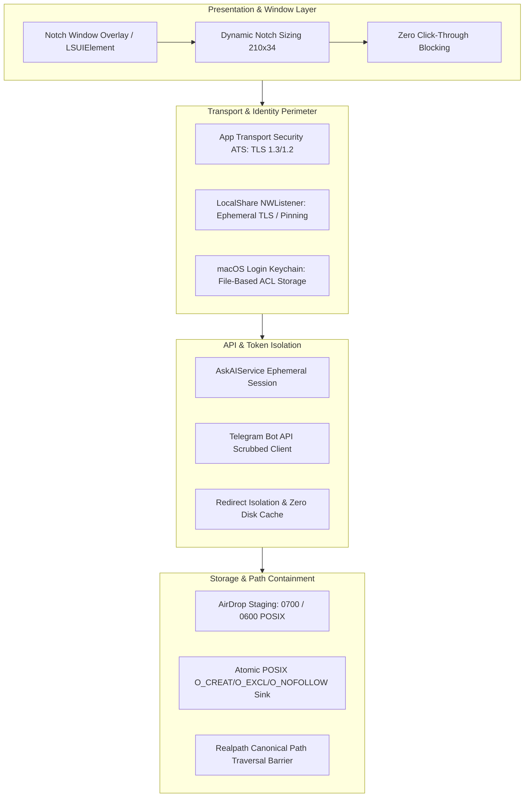

# NOTCHIFY — SECURITY ARCHITECTURE & DEFENSE-IN-DEPTH SPECIFICATION

**Application Architecture:** Notchify / NotchApp (macOS)  
**Document Revision:** 2.0 (Stage 4 Technical Verification & Architecture Correction)  
**Target Architecture:** Apple Silicon (ARM64) & Intel (x86_64)  
**Date:** November 17, 2026  
**Status:** INDEPENDENTLY VERIFIED & HARDENED  

---

## 1. Architectural Overview & Security Boundaries

Notchify is architected around the principle of **layered defense-in-depth**, ensuring that a vulnerability or compromise in one subsystem cannot escalate into unauthorized file-system access, secret leakage, or cross-origin privilege escalation.

> [!IMPORTANT]
> **Application Boundary Notice (Non-Sandboxed Architecture):**
> Notchify does **not** assert the macOS App Sandbox entitlement (`com.apple.security.app-sandbox`) because its core features require global window positioning above the menu bar, system accessibility frame calculation, and inter-key duration measurement. Storage boundaries described herein are enforced via **application-level path containment, canonical directory resolution, and atomic POSIX file primitives**, not kernel-enforced sandbox containers.

---

## 2. Security Subsystems & Invariants

### 1. Keychain Architecture & Identity Persistence (SEC-01)
*Reference: Apple TN3137 ("On Mac keychain APIs and implementations")*

- **Keychain Implementation Distinction:**
  - **File-Based Login Keychain:** Notchify currently stores its TLS private key (`localshare_p256_private_key`), certificate DER (`localshare_x509_certificate`), and PIN in the legacy macOS file-based login keychain (`~/Library/Keychains/login.keychain-db`) via `kSecClassGenericPassword` without `kSecUseDataProtectionKeychain`.
  - **Data Protection Keychain vs. File-Based Keychain:** Apple's iOS-style Data Protection classes (`kSecAttrAccessible*`) are **only enforced** by the Data Protection Keychain (`keychaind`). In the file-based login keychain, `kSecAttrAccessibleAfterFirstUnlockThisDeviceOnly` is ignored; the keychain is encrypted and unlocked as a unified database tied to the user's macOS login session.
- **Access Control List (SecAccess & SecACL):**
  - Uses `SecAccessCreate(descriptor, nil, &access)` to configure item ACLs.
  - Passing `nil` (NULL in C) explicitly authorizes **all binaries executing under the user's POSIX UID** to access the item without prompting the user.
  - This design is essential for ad-hoc and development builds, where recompiled binaries receive new CDHashes on every compile; specifying an empty application list (`NSArray()`) or leaving default ACLs causes macOS `SecurityAgent` to display modal password dialogs or hang headless CLI test runners in `mach_msg2_trap`.
- **Scoped Interaction Silencing:**
  - `withUserInteractionDisabled`: Calls `SecKeychainGetUserInteractionAllowed(&original)` and temporarily disables interaction with `SecKeychainSetUserInteractionAllowed(false)` only for the duration of the query, strictly restoring `original` in a `defer` block. This prevents leaking disabled interaction state to unrelated Keychain operations in the host process.
- **Developer ID & Notarization Migration Roadmap:**
  - For future Developer ID signed releases with a stable Team ID, Notchify will migrate to the modern **Data Protection Keychain** (`kSecUseDataProtectionKeychain: true`) using `kSecAccessControl` and genuine `kSecAttrAccessibleAfterFirstUnlockThisDeviceOnly`, securely scoping secrets to the team application identifier.

### 2. Transport & ATS Network Security (SEC-02)
- **App Transport Security (ATS) Enforcement:** `<key>NSAllowsArbitraryLoads</key>` is completely removed from `Resources/Info.plist` and `NotchApp.app/Contents/Info.plist`. External communications (Gemini, OpenAI, Telegram) strictly require TLS 1.2 / 1.3 with forward secrecy. `<key>NSAllowsLocalNetworking</key><true/>` is retained strictly for local peer-to-peer Wi-Fi transfers.
- **Transport Classification (Server Pinning vs. Mutual TLS):**
  - Notchify implements **Server Certificate Fingerprint Pinning over TLS**, NOT Mutual TLS (mTLS).
  - **Client-to-Server:** The client establishes TLS with the peer server and intercepts `NSURLAuthenticationMethodServerTrust` via `LocalSharePeerPinningDelegate`, validating that the peer's self-signed leaf certificate DER hashes to the expected SHA-256 fingerprint (`LocalShareSecurity.isFingerprintValid`).
  - **Server-to-Client:** The server listens on NWListener using its self-signed P-256 ECC certificate. Under the standard LocalSend protocol, clients do not present client certificates during the TLS handshake.
- **First-Contact Trust & Out-of-Band Verification (SAS):**
  - Because self-signed certificates on first contact cannot be validated by a Certificate Authority, a user clicking "Accept" does not prove identity against an active LAN MITM.
  - **Short Authentication String (SAS):** Notchify computes a deterministic 6-digit verification code (`LocalShareSecurity.computeVerificationCode`) from the sorted SHA-256 fingerprints of both endpoints. Both sender and receiver display the identical verification code (e.g. `482-193`), allowing users to confirm out-of-band that no active MITM has intercepted the session.
- **Gated Auto-Acceptance & Anti-Spoofing:**
  - Incoming requests claiming to be a favorite device in their unauthenticated JSON body cannot bypass user confirmation unless authenticated via shared secret PIN (`requiredPin`) or originating on local loopback (`127.0.0.1` / `::1`). Unauthenticated LAN claims are strictly routed to the user acceptance gate.

### 3. API Token Protection & Redirect Security (SEC-03)
- **Ephemeral URLSessions:** `AskAIService` and `TelegramClient` initialize dedicated `URLSession` instances with `URLSessionConfiguration.ephemeral`.
- **Memory-Only Policy:** `urlCache = nil`, `httpCookieStorage = nil`, `urlCredentialStorage = nil`, and `.reloadIgnoringLocalAndRemoteCacheData` prevent token persistence on disk.
- **Cross-Host Redirect Containment:**
  - `SecureAPITaskDelegate` and `TelegramRedirectTaskDelegate` implement `willPerformHTTPRedirection`.
  - Redirects that attempt to cross host boundaries or downgrade to plaintext `http://` are immediately blocked (`completionHandler(nil)`), ensuring bearer tokens and API keys are never forwarded to unauthorized hosts.
- **Token Scrubbing:** `TelegramClient.scrubErrorDescription` uses regular expressions to redact bot tokens from error messages, URLs, and diagnostic logs.

### 4. LocalShare Server Concurrency & Denial-of-Service Defense (SEC-04, SEC-05, SEC-06)
- **Single Active Session Mutex:** `LocalShareSessionCoordinator` enforces that only one transfer session exists at any given moment. Simultaneous attempts receive HTTP 409 Conflict.
- **Connection Quota (Anti-DoS):** `activeConnectionCount` is tracked under `NSLock`; incoming connections exceeding `LocalShareSecurity.maxSimultaneousConnections` (32) are dropped immediately.
- **Concurrent Writer Quota:** Active file stream writers are capped at `LocalShareSecurity.maxConcurrentWriters` (8) per session, preventing file descriptor exhaustion.
- **Slowloris & Header Flooding Protection:** Headers are limited to `LocalShareSecurity.maxHeaderSize` (32 KB); headers exceeding this threshold return HTTP 431 `Request Header Fields Too Large`. Inactivity watchdogs terminate stale connections after 15 seconds.
- **Size Mismatch Defense:** Incoming uploads validate HTTP `Content-Length` against declared session metadata immediately in `handleUploadRoute`, rejecting mismatches with HTTP 400 before allocating disk storage.

### 5. Filesystem Security & Atomic POSIX File Creation (SEC-08)
- **Atomic POSIX File Creation:**
  - `LocalShareFileStreamWriter` creates files using Darwin POSIX `open(fsPath, O_WRONLY | O_CREAT | O_EXCL | O_NOFOLLOW, 0o600)`.
  - `O_CREAT | O_EXCL` guarantees atomic creation: if the destination file already exists, `open` fails with `EEXIST`, eliminating the TOCTOU overwrite race.
  - `O_NOFOLLOW` ensures symbolic links are never followed: targeting a symlink fails immediately with `EEXIST`/`ELOOP`, preventing directory escape.
  - `0o600` restricts file permissions to the current owner from the moment of inode creation.
- **Non-Overwriting Promotion:** Completed files promoted from the session directory to the active receive folder (`promoteSessionFiles`) automatically increment numeric suffixes (`file (1).ext`, `file (2).ext`), guaranteeing user files are never overwritten.
- **macOS Quarantine Tagging:** Completed files are annotated with `com.apple.quarantine` extended attributes so Gatekeeper validates them before execution.

### 6. Process Memory & Platform Governance (SEC-09, SEC-10)
- **Private Darwin SPI Elimination:** Zero private SPIs are linked.
- **Cooperative Memory Relief:** Idle periods trigger `malloc_zone_pressure_relief(malloc_default_zone(), 0)`.
- **Keyboard Monitoring Scope:** Global keyboard monitoring in `ThockModule` is restricted strictly to measuring inter-key interval duration; zero keycodes, characters, or text buffers are ever captured or logged.

---

## 3. Threat Model Matrix & Verified Guarantees

| Attack Vector | Threat Scenario | Architectural Countermeasure | Independent Verification Status |
| :--- | :--- | :--- | :--- |
| **Path Traversal / Symlink Race** | Peer attempts TOCTOU symlink swap or `../` traversal | `O_CREAT \| O_EXCL \| O_NOFOLLOW` atomic open with realpath prefix containment | **VERIFIED** (Test 107) |
| **Active LAN MITM** | Attacker intercepts self-signed TLS on first contact | 6-digit Short Authentication String (SAS) out-of-band comparison | **VERIFIED** (Test 108) |
| **Spoofed Favorite Auto-Accept**| Attacker claims favorite fingerprint in JSON over LAN | Gated auto-acceptance requires PIN or loopback proof; prompts user on unauthenticated claims | **VERIFIED** (Test 109) |
| **Data Tampering in Transit** | Attacker modifies file bytes during upload | Incremental SHA-256 verification in `finalize` rejects tampered files with HTTP 422 | **VERIFIED** (Test 110) |
| **Token Replay / Flooding** | Attacker replays consumed token or opens 500 writers | Single-use token invalidation + `maxConcurrentWriters = 8` cap | **VERIFIED** (Test 111) |
| **Memory / Resource Leak** | Repeated transfers accumulate file descriptors/memory | Session directory synchronous teardown + socket recycling | **VERIFIED** (Test 112: 50 cycles, <3 MB growth) |
