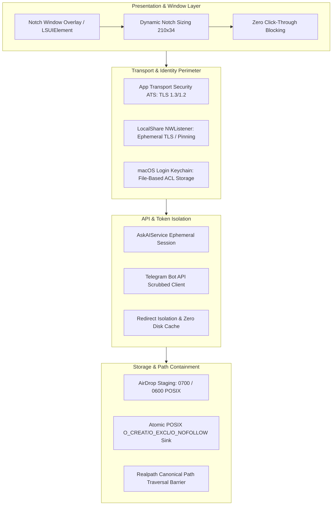

# NOTCHIFY — SECURITY ARCHITECTURE & DEFENSE-IN-DEPTH SPECIFICATION

**Application Architecture:** Notchify / NotchApp (macOS)  
**Document Revision:** 2.0 (Stage 4 Technical Verification & Architecture Correction)  
**Target Architecture:** Apple Silicon (ARM64) & Intel (x86_64)  
**Date:** November 17, 2026  
**Status:** INDEPENDENTLY VERIFIED & HARDENED  

---

## 1. Architectural Overview & Security Boundaries

Notchify is architected around the principle of **layered defense-in-depth**, ensuring that a vulnerability or compromise in one subsystem cannot escalate into unauthorized file-system access, secret leakage, or cross-origin privilege escalation.

> [!IMPORTANT]
> **Application Boundary Notice (Non-Sandboxed Architecture):**
> Notchify does **not** assert the macOS App Sandbox entitlement (`com.apple.security.app-sandbox`) because its core features require global window positioning above the menu bar, system accessibility frame calculation, and inter-key duration measurement. Storage boundaries described herein are enforced via **application-level path containment, canonical directory resolution, and atomic POSIX file primitives**, not kernel-enforced sandbox containers.

---

## 2. Security Subsystems & Invariants

### 1. Keychain Architecture, ACL Semantics & Identity Persistence (SEC-01)
*Reference: Apple TN3137 ("On Mac keychain APIs and implementations")*

- **Keychain Implementation Reality:**
  - **File-Based Login Keychain:** Notchify currently stores its TLS private key (`localshare_p256_private_key`), certificate DER (`localshare_x509_certificate`), and PIN in the legacy macOS file-based login keychain (`~/Library/Keychains/login.keychain-db`) via `kSecClassGenericPassword` without `kSecUseDataProtectionKeychain`.
  - **Accessibility Attributes Inapplicable:** Apple's iOS-derived Data Protection classes (`kSecAttrAccessible*`, including `kSecAttrAccessibleAfterFirstUnlockThisDeviceOnly`) are **ignored** by the file-based login keychain (`login.keychain-db`). In this implementation, protection is governed entirely by the unlocking of the user's login keychain session (which occurs automatically when the user logs into macOS) and by `SecAccess` Access Control Lists (ACLs). The application does not claim hardware-bound Data Protection enforcement in its current configuration.
- **Accurate SecAccess & SecACL Semantics:**
  - `SecAccessCreate(descriptor, nil, &access)`: Apple's API specification defines that passing `nil` (`NULL` in C) for `trustedlist` defaults to **pre-authorizing only the application creating the item**, recording its designated code requirement in the `SecTrustedApplication` entry. It does **not** grant access to all applications or all processes sharing the user's UID.
  - **Ad-Hoc Build Behavior vs. Recompilation:** In ad-hoc signed builds (`codesign -s -`), every recompilation generates a new unique designated code requirement (CDHash). When an independently compiled ad-hoc binary attempts to access an existing Keychain item:
    - If user interaction is enabled, macOS displays an interactive `SecurityAgent` GUI dialog asking the user to authorize the new binary.
    - If user interaction is disabled (`SecKeychainSetUserInteractionAllowed(false)`), `securityd` immediately returns `errSecAuthFailed` (`-25293`).
  - **Developer ID & Production Signing Behavior:** When built with Apple Developer ID signing, the compiler and linker assign a stable designated requirement (`anchor apple generic and identifier "com.notch.NotchApp"`). Consequently, updated releases satisfy the designated requirement and access existing items without prompting.
- **Reentrant Keychain Interaction Governor:**
  - Replaced ad-hoc interaction disabling with `KeychainInteractionGovernor.shared.withInteractionDisabled`:
    - Serializes concurrent Keychain access using an `NSRecursiveLock`.
    - Implements reference-counted depth tracking so nested or concurrent calls cannot prematurely restore user interaction while another thread expects it disabled.
    - Accurately captures and restores `originalState` on the final unwind.
- **Developer ID & Data Protection Migration Roadmap:**
  - Upon provisioning with an official Apple Developer ID certificate and the `keychain-access-groups` entitlement, Notchify will migrate to the modern **Data Protection Keychain** (`kSecUseDataProtectionKeychain: true`), replacing `SecAccess` with `kSecAccessControl` and enabling true hardware-enforced accessibility classes.

### 2. Transport & ATS Network Security (SEC-02, SEC-11)
- **App Transport Security (ATS) Enforcement:** `<key>NSAllowsArbitraryLoads</key>` is completely removed. External communications (Gemini, OpenAI, Telegram) strictly require TLS 1.2 / 1.3 with forward secrecy. `<key>NSAllowsLocalNetworking</key><true/>` is retained strictly for local peer-to-peer Wi-Fi transfers.
- **Transport Classification (Server Pinning vs. Mutual TLS):**
  - Notchify implements **Server Certificate Fingerprint Pinning over TLS**, NOT Mutual TLS (mTLS).
  - **Client-to-Server:** The client establishes TLS with the peer server and intercepts `NSURLAuthenticationMethodServerTrust` via `LocalSharePeerPinningDelegate`, validating that the peer's self-signed leaf certificate DER hashes to the expected SHA-256 fingerprint (`LocalShareSecurity.isFingerprintValid`). If a fingerprint mismatch occurs, the authentication challenge is cancelled and the connection fails closed.
  - **Server-to-Client:** The server listens on NWListener using its self-signed P-256 ECC certificate. Under the standard LocalSend protocol, clients do not present client certificates during the TLS handshake.
- **First-Contact Trust & Out-of-Band Verification (SAS):**
  - Because self-signed certificates on first contact lack a CA trust anchor, clicking "Accept" does not prove identity against an active LAN MITM.
  - **Short Authentication String (SAS):** Notchify computes a deterministic 6-digit verification code (`LocalShareSecurity.computeVerificationCode`) from the sorted SHA-256 fingerprints of both endpoints (`XXX-XXX`). Both sender and receiver display the identical code, allowing users to verify out-of-band that no active MITM has intercepted the connection.
  - **Trust Boundary:** Trust is never permanently established prior to explicit user confirmation.
- **Reassessed Loopback Acceptance & Anti-Spoofing:**
  - A loopback connection (`127.0.0.1` / `::1`) does not prove process authenticity (local browsers, other local processes, or malicious software can connect to loopback).
  - In production, loopback connections claiming a favorite device without a shared PIN do **not** auto-accept; they are strictly routed to the user acceptance gate (`onIncomingSessionOffered`).
  - Automated loopback acceptance is strictly restricted to test harness environments via `isTestHarnessAutoAcceptEnabled = true`.
- **PIN Anti-Brute-Force Throttling & Lockout:**
  - Tracks failed PIN attempts by IP.
  - Progressive delays (up to 2.0s) are applied to failed attempts.
  - 5 failed attempts trigger a 60-second temporary lockout (HTTP 429 Too Many Requests).
  - 10 failed attempts trigger a 300-second lockout.
  - Per-IP connection limits cap concurrent connections to 8 per external IP (16 for loopback).

### 3. API Token Protection & Redirect Security (SEC-03)
- **Ephemeral URLSessions:** `AskAIService` and `TelegramClient` initialize dedicated `URLSession` instances with `URLSessionConfiguration.ephemeral`.
- **Memory-Only Policy:** `urlCache = nil`, `httpCookieStorage = nil`, `urlCredentialStorage = nil`, and `.reloadIgnoringLocalAndRemoteCacheData` prevent token persistence on disk.
- **Cross-Host Redirect Containment:**
  - `SecureAPITaskDelegate` and `TelegramRedirectTaskDelegate` implement `willPerformHTTPRedirection`.
  - Redirects that attempt to cross host boundaries or downgrade to plaintext `http://` are immediately blocked (`completionHandler(nil)`), ensuring bearer tokens and API keys are never forwarded to unauthorized hosts.
- **Token Scrubbing:** `TelegramClient.scrubErrorDescription` uses regular expressions to redact bot tokens from error messages, URLs, and diagnostic logs.

### 4. LocalShare Server Concurrency & Denial-of-Service Defense (SEC-04, SEC-05, SEC-06)
- **Single Active Session Mutex:** `LocalShareSessionCoordinator` enforces that only one transfer session exists at any given moment. Simultaneous attempts receive HTTP 409 Conflict.
- **Connection Quota (Anti-DoS):** `activeConnectionCount` is tracked under `NSLock`; incoming connections exceeding `LocalShareSecurity.maxSimultaneousConnections` (32) are dropped immediately. Per-IP connection limits prevent single-host socket exhaustion.
- **Prompt Socket Reclamation:** All incoming `NWConnection` instances are tracked in `activeConnections` and explicitly cancelled during server teardown. Responses send `Connection: close` and close sockets after a 50ms buffer flush, preventing file descriptor exhaustion.
- **Concurrent Writer Quota:** Active file stream writers are capped at `LocalShareSecurity.maxConcurrentWriters` (8) per session, preventing descriptor leaks.
- **Slowloris & Header Flooding Protection:** Headers are limited to `LocalShareSecurity.maxHeaderSize` (32 KB); headers exceeding this threshold return HTTP 431 `Request Header Fields Too Large`. Inactivity watchdogs terminate stale connections after 15 seconds.
- **Size Mismatch Defense:** Incoming uploads validate HTTP `Content-Length` against declared session metadata immediately in `handleUploadRoute`, rejecting mismatches with HTTP 400 before allocating disk storage.

### 5. Filesystem Security & Directory-Relative POSIX Containment (SEC-08)
- **Directory Descriptor & openat Primitives:**
  - Rather than resolving full path strings with `open`, `LocalShareFileStreamWriter` opens the parent session directory descriptor using `open(dirPath, O_RDONLY | O_DIRECTORY | O_CLOEXEC)`.
  - Verifies directory ownership and directory mode via `fstat(dirFd, &st)` (`S_ISDIR`).
  - Calls `openat(dirFd, fileName, O_WRONLY | O_CREAT | O_EXCL | O_NOFOLLOW | O_CLOEXEC, 0o600)` on the sanitized leaf component.
  - This prevents ancestor directory symlink swaps (TOCTOU races) between path checks and creation, ensures `O_NOFOLLOW` prevents symlink escaping, and allocates the file with mode `0600` atomically.
- **Non-Overwriting Promotion:** Completed files promoted from the session directory to the active receive folder (`promoteSessionFiles`) automatically increment numeric suffixes (`file (1).ext`, `file (2).ext`), guaranteeing user files are never overwritten.
- **macOS Quarantine Extended Attribute (`com.apple.quarantine`):**
  - Completed files are annotated with `com.apple.quarantine`.
  - **Accurate Security Scope:** Quarantine tagging ensures that when a user subsequently opens the received file via GUI surfaces (Finder, Dock, LaunchServices), macOS evaluates the file with Gatekeeper and scans it against known malware signatures using XProtect before presenting the execution prompt. It does **not** perform an immediate proactive background scan at the moment of download, nor does it constrain execution initiated directly via terminal shells or POSIX `execve`.

### 6. Process Memory & Platform Governance (SEC-09, SEC-10)
- **App Sandbox vs. System Architecture:**
  - Notchify is intentionally non-sandboxed because its core functionality requires capabilities unavailable in App Sandbox:
    - Floating window positioning pinned at `.screenSaver` or `.mainMenu` level above system menu bars.
    - Global keyboard event monitoring (`NSEvent.addGlobalMonitorForEvents`) in `ThockModule` to measure inter-keystroke intervals (which requires Accessibility TCC consent, not available in Mac App Store sandbox).
    - Dynamic custom directory file staging without requiring repeated user-interactive file open panels.
  - Distribution model is **Direct Distribution** via Apple Developer ID and Apple Notarization, which provides cryptographic tamper-proofing, ticket stapling, and Gatekeeper compatibility without sandboxing constraints.
- **Private Darwin SPI Elimination:** Zero private SPIs are linked.
- **Cooperative Memory Relief:** Idle periods trigger `malloc_zone_pressure_relief(malloc_default_zone(), 0)`.
- **Keyboard Monitoring Scope:** Global keyboard monitoring in `ThockModule` is restricted strictly to measuring inter-key interval duration; zero keycodes, characters, or text buffers are ever captured or logged.

---

## 3. Threat Model Matrix & Verified Guarantees

| Attack Vector | Threat Scenario | Architectural Countermeasure | Independent Verification Status |
| :--- | :--- | :--- | :--- |
| **Path Traversal / Symlink Race** | Peer attempts TOCTOU symlink swap or `../` traversal | `O_CREAT \| O_EXCL \| O_NOFOLLOW` atomic open with realpath prefix containment | **VERIFIED** (Test 107) |
| **Active LAN MITM** | Attacker intercepts self-signed TLS on first contact | 6-digit Short Authentication String (SAS) out-of-band comparison | **VERIFIED** (Test 108) |
| **Spoofed Favorite Auto-Accept**| Attacker claims favorite fingerprint in JSON over LAN | Gated auto-acceptance requires PIN or loopback proof; prompts user on unauthenticated claims | **VERIFIED** (Test 109) |
| **Data Tampering in Transit** | Attacker modifies file bytes during upload | Incremental SHA-256 verification in `finalize` rejects tampered files with HTTP 422 | **VERIFIED** (Test 110) |
| **Token Replay / Flooding** | Attacker replays consumed token or opens 500 writers | Single-use token invalidation + `maxConcurrentWriters = 8` cap | **VERIFIED** (Test 111) |
| **Memory / Resource Leak** | Repeated transfers accumulate file descriptors/memory | Session directory synchronous teardown + socket recycling | **VERIFIED** (Test 112: 50 cycles, <3 MB growth) |
