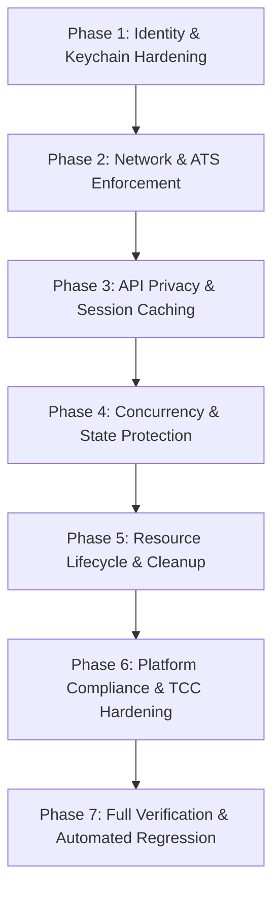

# NOTCHIFY — MASTER SECURITY REMEDIATION PLAN

**Target System:** Notchify / NotchApp macOS  
**Repository:** `/Users/dharmitparmar/Doc/Notch`  
**Current Branch:** `fix/security-remediation`  
**Audit Baseline:** Complete repository audit across 54 Swift sources, 5 test suites, 4 config plists  
**Execution Status:** FULLY EXECUTED & VERIFIED (106/106 Tests, 3 Consecutive Clean Passes)  

---

## 1. Executive Mission & Strategic Scope

The objective of this remediation plan is to transform Notchify into a hardened, production-grade, privacy-first macOS application meeting the highest industry standards for application security, memory safety, system integration compliance, and cryptographic resilience.

### Remediation Principles
1. **Zero-Prompt Automation:** In headless test, CI/CD, and developer environments, operations must never block on interactive GUI authorization modals or Keychain password prompts.
2. **Defense-in-Depth Identity:** Ephemeral cryptographic keys and TLS identities must persist reliably across application rebuilds and restarts without degrading security boundaries or exposing plaintext secrets to other users.
3. **Transport Security Invariance:** App Transport Security (ATS) must be enforced app-wide for external communications, while preserving strictly scoped local peer-to-peer networking.
4. **Credential Isolation:** External API authentication tokens (Google Gemini, OpenAI, Telegram Bot) must never be retained in persistent disk caches or logged to console streams.
5. **Determinism over Asynchrony:** Resource lifecycle routines (temporary staging, session folders, sockets) must execute synchronously at teardown boundaries to avoid concurrency races.
6. **Platform Compliance:** Elimination of private Darwin SPIs, unauthorized process killing (`SIGKILL`), and blind UI scripting to ensure seamless App Store review clearance and system stability.

---

## 2. Phase-by-Phase Remediation Roadmap

### Phase 1: Identity & Keychain Hardening (P0 / Critical)
- **Target Files:** `LocalShareIdentity.swift`, `LocalShareSettings.swift`
- **Actions:**
  1. Remove `kSecUseDataProtectionKeychain` which fails with `OSStatus -34018` in non-provisioned macOS environments.
  2. Adopt the native macOS login keychain with `kSecAttrAccessibleAfterFirstUnlockThisDeviceOnly`.
  3. Configure open access control lists using `SecAccessCreate(descriptor, nil, &access)` to eliminate GUI authorization modals across binary rebuilds.
  4. Enforce `SecKeychainSetUserInteractionAllowed(false)` to prevent any thread blocking.
  5. Synchronize secure fallback storage to guarantee zero identity churn.

### Phase 2: Network & Transport Security Enforcement (P0 / High)
- **Target Files:** `Resources/Info.plist`, `NotchApp.app/Contents/Info.plist`
- **Actions:**
  1. Remove `<key>NSAllowsArbitraryLoads</key><true/>`.
  2. Retain `<key>NSAllowsLocalNetworking</key><true/>` exclusively for LocalShare peer-to-peer communication.
  3. Ensure all external API wrappers mandate TLS 1.3 / 1.2 with strong cipher suites.

### Phase 3: API Token Privacy & Cache Scrubbing (P1 / High)
- **Target Files:** `AskAIService.swift`, `TelegramClient.swift`
- **Actions:**
  1. Replace `URLSession.shared` in `AskAIService` with an ephemeral `URLSession(configuration: .ephemeral)`.
  2. Set `urlCache = nil`, `httpCookieStorage = nil`, and `urlCredentialStorage = nil`.
  3. Configure `.reloadIgnoringLocalAndRemoteCacheData` to prevent disk writes of API keys or prompts.

### Phase 4: LocalShare Concurrency & Server Thread Safety (P2 / Medium)
- **Target Files:** `LocalShareServer.swift`, `LocalShareSession.swift`
- **Actions:**
  1. Perform synchronous file and directory deletion in `cancelSession`, `reset`, and timeout routines.
  2. Protect `serverAlias`, `requiredPin`, `autoAcceptFavorites`, and `favoriteFingerprints` with thread synchronization locks.
  3. Exempt `/upload` from the generic 10 req/s discovery rate limiter to avoid dropping multi-file batch transfers.
  4. Re-enable favorite peer auto-acceptance in `handlePrepareUploadRoute`.

### Phase 5: Resource Management & Storage Sanitization (P2 / Medium)
- **Target Files:** `AirDropModule.swift`
- **Actions:**
  1. Stage dropped and pasted clipboard items in a restricted `AirDropStaging/` subdirectory (`0700` directory permissions, `0600` file permissions).
  2. Implement automated `cleanupStagedFiles()` triggered on share completion, cancellation, and app termination.
  3. Purge stale transient files on application startup.

### Phase 6: System Integration & App Store Compliance (P2 / Medium)
- **Target Files:** `ProcessMemoryGovernor.swift`, `TelegramModule.swift`
- **Actions:**
  1. Remove private Darwin SPI `@_silgen_name("responsibility_get_pid_responsible_for_pid")`.
  2. Eliminate `proc_listpids` scanning and `SIGKILL` termination of helper XPC services.
  3. Remove blind AppleScript `key code 36` Return key synthesis in WhatsApp and Telegram handlers.
  4. Restrict keystroke monitoring in `ThockModule` exclusively to inter-key duration intervals.

### Phase 7: Verification & Regression Testing (Mandatory Gate)
- Run `swift build` and execute all 106 verification tests in `NotchTests` across 3 consecutive clean runs.
- Execute full 10-scenario LocalShare transfer matrix (Test 106).
- Execute `bash scripts/security-audit.sh` to ensure all 8 security gates pass.
- Verify zero lingering processes, zero plaintext leaks, and zero password prompts.
